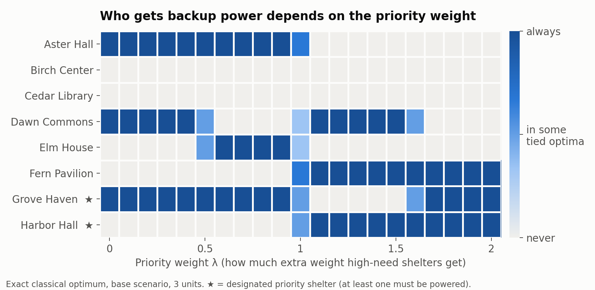
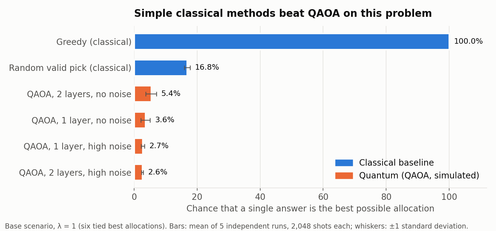
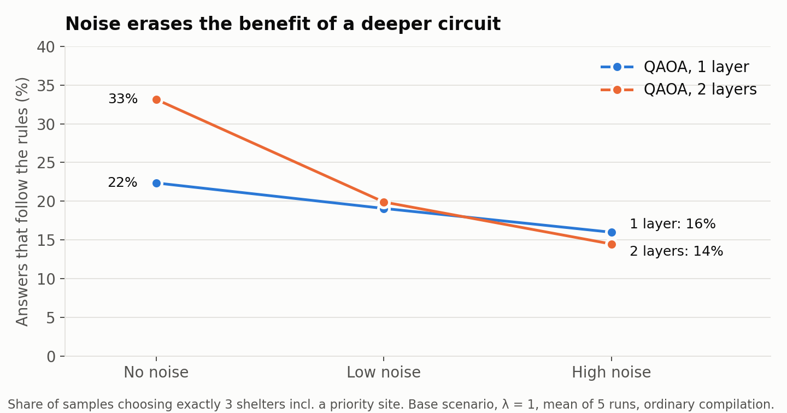

# LifelineQ

**An auditable quantum allocation experiment for Qompute 2026, Track 2: Optimizing for People.** Scenario: during a heat wave, a blackout cuts power to eight cooling shelters in a fictional city. The shelters need backup power, but only three identical compatible units are available. At least one designated priority shelter must receive a unit. LifelineQ shows how explicit priorities, shallow QAOA circuits, compilation and controlled noise affect the resulting allocation distribution.

All scores, names, coordinates, city diagrams and hardware noise are **synthetic**. Utility is a proxy, not people saved, electricity delivered or a validated emergency plan. Each unit supports one shelter for a fixed period. Electrical sizing, travel and changing demand are outside this prototype. No real quantum hardware, account, GPU, API key or paid service is required.

## Team

- **[Alexander Jacob](https://www.linkedin.com/in/alexander-jacob-0471aa295/)**
- **[Shravan Suresh](https://www.linkedin.com/in/shravan-suresh-63b8aa373/)**

## Key findings

- **The "optimal" answer is a value choice.** Changing one priority weight changes which shelters get power. At λ = 0 the exact optimum powers Aster Hall, Dawn Commons and Grove Haven; at λ = 2 it powers Fern Pavilion, Grove Haven and Harbor Hall. At λ = 1 six different allocations tie exactly, so the math cannot decide and a person must.
- **Some shelters are never served.** In the base scenario, Birch Center and Cedar Library receive no unit at any weight from 0 to 2, because they overlap with Aster Hall.
- **Simple classical methods beat QAOA here.** A noiseless one-layer QAOA circuit sampled a best allocation about 3.6% of the time (5.4% with two layers). Picking uniformly among valid allocations did so about 16.8% of the time, and a greedy method found the exact optimum in all nine scenario/weight cases. No quantum advantage is claimed.
- **Noise wipes out the gain from a deeper circuit.** Rule-following samples fell from 22% to 16% (one layer) and from 33% to 14% (two layers) between no noise and high noise.
- **Smarter compilation cut gates but not reliably errors.** Searching four compiler seeds removed two-qubit gates in 24 of 30 base fits (mean 102 → 89 at one layer), but changes in allocation quality were small and mixed.







Figures are drawn from the checked-in results by `python scripts/make_figures.py` (needs `matplotlib`). Full numbers, spreads and caveats are in [results/REPORT.md](results/REPORT.md).

## Societal impact and responsible use

**Who defines "optimal"?** The objective rewards benefit, extra priority for high-need shelters, and a penalty for overlapping service. Each of those is a judgment. λ is not a measure of fairness; it is a dial that encodes whose needs count more, and the figure above shows it decides who receives power. In a real emergency those choices belong to accountable officials and the affected communities, not to whoever writes the cost function.

**Who gets left out?** An "optimal" allocation can systematically exclude the same places. Birch Center and Cedar Library are never powered in our base scenario, and people who depend on them would receive nothing under this model. Detecting that pattern requires looking across many priority settings, not only at one optimum. We would want any real tool to report who is excluded alongside what is selected.

**When should an algorithm decide?** At λ = 1 six allocations tie exactly. An algorithm would silently break that tie; we think a person should. More broadly, a tool like this should present trade-offs to decision-makers rather than make the allocation itself.

**Can a noisy quantum answer be trusted?** Not without checking. A shallow QAOA circuit often proposed allocations that broke the rules: in more than half of the recorded quantum runs, its single most frequent answer was invalid. Every quantum answer in this project is verified against an exact classical solution, a greedy baseline and random sampling, and each saved result carries its code fingerprint so it can be audited. For decisions that affect people's safety, unverified quantum output should not be used.

**Who benefits from quantum optimization?** If quantum methods eventually outperform classical ones, the first access will likely go to organizations that can pay for advanced hardware, not to the under-resourced communities that face the hardest allocation problems. Free cloud access has opened learning to students like us, but equitable access to useful machines remains an open question.

**Is the computation justified?** At eight shelters the exact answer takes a fraction of a second on a laptop. We use this small instance deliberately so every claim can be checked. Spending quantum or classical resources on a harder method only makes sense once it clearly beats simpler tools.

**Limits of this prototype.** All names, scores, coordinates and noise are synthetic. Utility is a proxy, not lives saved or energy delivered. A real system would need validated demand and travel data, electrical engineering review, community input, an appeals process and a tested non-algorithmic fallback.

## Run locally

The tested environment is **Python 3.10.11 on Windows**, with Qiskit 2.5.2, Qiskit Aer 0.17.2, NumPy 2.2.6, SciPy 1.15.3, pandas 2.3.3, Plotly 7.1.0, Streamlit 1.65.0 and pytest 9.1.1. Run commands from the repository root. Top-level dependencies are pinned in `requirements.txt`; `requirements-lock.txt` records the full tested environment. A virtual environment keeps the project independent of other Python installations. The macOS/Linux instructions use the same pinned packages, but those operating systems were not tested in this build.

Windows PowerShell, without needing to change script execution policy:

```powershell
py -3.10 -m venv .venv
.\.venv\Scripts\python.exe -m pip install --upgrade pip
.\.venv\Scripts\python.exe -m pip install -r requirements.txt
.\.venv\Scripts\python.exe -m pytest -q
.\.venv\Scripts\python.exe -m lifelineq.experiments --preset quick
.\.venv\Scripts\python.exe -m streamlit run app.py
```

macOS / Linux:

```bash
python3.10 -m venv .venv
source .venv/bin/activate
python -m pip install --upgrade pip
python -m pip install -r requirements.txt
python -m pytest -q
python -m lifelineq.experiments --preset quick
python -m streamlit run app.py
```

With the environment activated, the complete bounded benchmark is:

```bash
python -m lifelineq.experiments --preset benchmark
python -m lifelineq.experiments --preset robustness
python scripts/summarize_results.py
```

On PowerShell without activation, replace `python` with `.\.venv\Scripts\python.exe`. The app can also be launched with `streamlit run app.py` after activation. The full experiment remains small enough for a laptop, but takes longer than the quick run; use the checked-in recorded results for a reliable presentation.

## What the demo shows

“Explore priorities” makes the classical allocation and tradeoff visible. “Stress-test quantum noise” compares actual Aer samples against exact enumeration, deterministic greedy allocation and uniform feasible random sampling. The interface separates the most frequent raw assignment from the best feasible observed assignment, shows failed constraints and labels saved versus live results. JSON and CSV exports retain the experiment's settings.

Saved results are shown only when their scenario and settings match. Changing inputs must never relabel an old run as a new one. Provenance records the input data, configuration, code/version identity, fitted parameters, seeds, shots, compilation and timings. Re-run experiments after a code or dependency change if you need results for the new version.

The computational modules are `lifelineq/model.py` (encoding and exact reference), `baselines.py` (greedy and feasible random), `quantum.py` (QAOA fitting), `noise.py` (routing and Aer execution), `metrics.py` (distribution statistics), `provenance.py` (cache identity), and `experiments.py` (CLI and saved artifacts). `app.py` presents them through Streamlit; `data/`, `tests/`, `results/` and `docs/` hold the fixtures, checks, measurements and presentation material.

## Model and classical reference

Shelter indices are zero-based, `0,…,7`. The base fixture is:

```text
benefit b = [10, 9, 8, 7, 6, 5, 4, 3]
priority v = [1, 1, 2, 4, 6, 7, 9, 10]
overlap r = {(0,1):6, (0,2):5, (1,2):4,
             (6,7):5, (3,4):2, (4,5):3}
rho = 1; K = 3; priority sites = {6,7}
```

All other overlap entries are zero. A selected pair loses overlap utility to discourage redundant choices; overlaps do not represent measured catchment areas. The objective is

$$
U_\lambda(x)=\sum_i (b_i+\lambda v_i)x_i
 -\rho\sum_{i<j}r_{ij}x_ix_j,
\quad \sum_i x_i=K,\quad x_6+x_7\ge1.
$$

The classical reference enumerates the feasible combinations, retains all tied optima and reports the full feasible set. There are 36 feasible assignments when `K=3`; separate encoding tests check all 256 assignments, including infeasible ones. Lambda changes the objective, so do not interpret utilities at different lambda values as an improvement under one fixed metric.

| Lambda | Verified optimum | All optimal selections (zero-based indices) |
|---|---:|---|
| 0 | 21 | `{0,3,6}`: Aster Hall, Dawn Commons, Grove Haven |
| 1 | 36 | `{0,4,6}`, `{0,5,6}`, `{3,5,6}`, `{0,4,7}`, `{0,5,7}`, `{3,5,7}` |
| 2 | 59 | `{5,6,7}`: Fern Pavilion, Grove Haven, Harbor Hall |

The fixed robustness fixtures were chosen before running the benchmark. [demand_shift.json](data/demand_shift.json) changes benefits to `[9,9,9,6,6,6,4,4]` and priorities to `[1,2,2,4,7,6,8,10]`, keeping the base overlaps. [overlap_shift.json](data/overlap_shift.json) keeps base scores and changes overlaps to `(0,1):4, (0,2):6, (1,2):3, (6,7):6, (3,4):3, (4,5):2, (2,3):2, (5,7):2`. Both retain `K=3`, `rho=1` and priority sites 6/7. Full names and synthetic diagram coordinates are in each JSON file.

The deterministic greedy comparator creates a feasible allocation using marginal utility and a deterministic tie rule, with an optional one-swap improvement. Uniform feasible random draws are independent and uniform over the enumerated feasible set. Their budget matches the experiment's stated sample budget. This is an oracle-informed classical comparison that uses enumeration for feasibility, not a scalable sampler; utility is not used to favor draws.

Lambda is a chosen priority weight, not an objective definition of fairness. The author chose priority sites for this synthetic example. In a real allocation process, affected communities and accountable decision makers would need to validate scores, choose constraints and review who is excluded. An unselected shelter receives no backup unit under this model.

## QUBO and Hamiltonian derivation

Let `s_i=b_i+lambda*v_i`. Minimize

$$
E(x)=-U_\lambda(x)+P(\sum_i x_i-K)^2+P(1-x_6)(1-x_7),
\qquad P=1+\sum_i|s_i|+\rho\sum_{i<j}|r_{ij}|.
$$

For any two binary assignments, each linear or quadratic monomial changes by at most one. Their utility difference is therefore at most `B=sum |s_i| + rho*sum |r_ij|`. Every infeasible assignment incurs at least `P=1+B`, whereas a feasible one has zero penalty. Thus every infeasible assignment costs more than every feasible one. Input validation rejects impossible allocations and invalid weights. This guarantee concerns the global minimum, not every sample of a shallow approximate circuit.

Using `x_i²=x_i`, write `E=c+sum a_i*x_i+sum d_ij*x_i*x_j`, with

$$
\begin{aligned}
c&=P(K^2+1),\\
a_i&=-s_i+P(1-2K)-P\,\mathbf1_{i\in\{6,7\}},\\
d_{ij}&=\rho r_{ij}+2P+P\,\mathbf1_{(i,j)=(6,7)}.
\end{aligned}
$$

For `x_i=(1-Z_i)/2`, the diagonal cost is `E=offset+sum h_i*Z_i+sum J_ij*Z_i*Z_j`, where

$$
\mathrm{offset}=c+\frac12\sum_i a_i+\frac14\sum_{i<j}d_{ij},\qquad
h_i=-\frac{a_i}{2}-\frac14\sum_{j\ne i}d_{ij},\qquad
J_{ij}=\frac{d_{ij}}4.
$$

The nonconstant terms are a Qiskit `SparsePauliOp`. The implementation retains the offset and normalizes by a positive scale based on the largest absolute nonconstant Pauli coefficient. Multiplication by this positive scale and restoration of the offset recover the original energy; reported utility and regret remain in the original proxy units. The offset affects energy accounting but only a global phase in cost evolution, so it can be omitted from the circuit.

Tests compare classical cost with every Hamiltonian diagonal entry, including offset and scale. Qiskit strings display bit 0 on the right: `01001001` selects shelters `{0,3,6}`. Measurements are attached to logical classical destinations before routing, and decoded routed probabilities are checked against the original circuit. See the [official bit-ordering guide](https://quantum.cloud.ibm.com/docs/en/guides/bit-ordering).

## Quantum and noise protocol

The circuit uses Qiskit's [`qaoa_ansatz`](https://quantum.cloud.ibm.com/docs/en/api/qiskit/qiskit.circuit.library.qaoa_ansatz) with the usual initial superposition and X mixer. `p` is the number of cost/mixer layers and introduces `2p` angles. SciPy COBYLA fits those angles using the ideal Qiskit statevector expectation of the normalized energy, with fixed evaluation budgets and multiple random starts. Angles start uniformly within the chosen bounds: beta in `[0, pi]`, gamma in `[0, 2*pi]`. Gamma's bound is a finite search choice, not an assumed full period for the normalized weighted Hamiltonian; better solutions may exist outside it. The lowest training energy selects the fit. The exact optimum is reserved for reporting, not parameter selection or state preparation.

For each scenario/lambda/p/seed, train once and freeze the parameters across both compiler strategies and every noise level. Noise evaluations return actual Qiskit Aer counts. Density-matrix execution evolves the specified noisy channel on the CPU; `max_parallel_threads=1` avoids unnecessary thread overhead for this small circuit. Fitting is ideal and noiseless; this is not noise-aware optimization.

The synthetic hardware graph is a bidirectional eight-qubit ring. Both strategies use basis `rz, sx, x, cx` and transpiler optimization level 2:

1. **Ordinary:** one fixed recorded compiler seed.
2. **Searched:** four recorded compiler seeds, including the ordinary candidate; select the fewest two-qubit gates, then lowest depth, before any noisy results are evaluated.

Both use the same topology, fitted circuit, noise parameters and shots. The search's time and candidate count are reported. Noiseless distribution equivalence is verified after routing. Fewer gates alone do not establish improved allocation quality, and a tie is a valid outcome. This is **error suppression through compilation**, not quantum error correction.

| Preset | Depolarizing parameter on `sx,x` | Depolarizing parameter on `cx` | Per-bit symmetric readout flip |
|---|---:|---:|---:|
| zero | 0 | 0 | 0 |
| low | 0.001 | 0.01 | 0.01 |
| high | 0.005 | 0.03 | 0.03 |

`rz` is treated as an ideal virtual operation in this synthetic model. A depolarizing parameter `d` means `rho_state → (1−d)rho_state+d I/2^n`; it is not a literal probability of a nonidentity Pauli error. See [Aer's channel definition](https://qiskit.github.io/qiskit-aer/stubs/qiskit_aer.noise.depolarizing_error.html). Noise presets are controlled stress tests, not calibrated devices; they omit timing-dependent relaxation, drift, coherent errors, leakage and crosstalk.

| Experiment | Scenarios | Lambda | p | Independent seeds | Shots per execution | Starts × budget | Compiler candidates |
|---|---|---|---|---|---:|---|---:|
| quick | base | 1 | 1 | 11 | 1,024 | 2 × 60 | 4 |
| benchmark | base | 0, 1, 2 | 1, 2 | 11, 22, 33, 44, 55 | 2,048 | 2 × 80 | 4 |
| robustness | two predefined perturbations | 0, 1, 2 | 1, 2 | 11, 22, 33, 44, 55 | 2,048 | 2 × 80 | 4 |

Every fit has an unrouted ideal execution, plus both routed compilation strategies at all three noise levels. The benchmark has 30 independently trained circuits, **210 quantum executions** (180 routed comparisons plus 30 ideal) and 30 uniform-feasible baseline executions. Robustness has 60 fits, 420 quantum executions and 60 uniform-feasible executions across two fixed scenarios. The ordinary compiler seed is `17000+seed`; search candidates use it and the next three integers. Evaluation uses `100000+seed` across all quantum arms of a fit, while the random baseline uses `200000+seed`. Thus compilation comparisons are paired within each fit. Optimization settings, convergence status, objective evaluations, fit time, simulation time, shots, circuit depth and two-qubit gate count are saved. Negative results and failed attempts remain in the result files.

## Read results correctly

| Metric | Definition |
|---|---|
| Feasible-sample rate | Feasible shots / all shots; both allocation constraints must pass. |
| Exact-optimum probability | Shots at any tied exact feasible optimum / all shots. |
| Mean feasible utility | Count-weighted utility conditional on feasibility. |
| Mean feasible regret | Exact optimum minus mean feasible utility at the same scenario and lambda. |
| Best observed feasible regret | Exact optimum minus best feasible utility seen; a diagnostic strongly affected by shot budget. |
| No-feasible failure | No feasible shot; conditional utility/regret and the best feasible sample are undefined. |

The most frequent raw sample is shown separately and may be infeasible. A labeled classical fallback, if shown, is not a quantum sample. Feasibility filtering is classical post-processing, and discarding invalid shots must never hide their rate.

Individual probability intervals are 95% Wilson intervals for finite-shot uncertainty. Conditional utility has a standard error computed only from feasible shots. Across independently optimized seeds, means and sample standard deviations describe run-to-run variation; they are separate from shot uncertainty. No test requires quantum performance to beat classical methods or noise to worsen every metric monotonically.

## Measured results

The completed benchmark and robustness grids contain **90 fits, 630 quantum executions and 90 uniform-feasible executions**, with 2,048 shots each. All 90 experiment runs completed without an execution error. The [generated measurement report](results/REPORT.md) records their exact source hash, versions, costs, paired compiler effects and individual shot intervals. Reproduce that report with `python scripts/summarize_results.py`; it rejects stale or mismatched artifacts. Earlier development runs are retained under `results/archive/development-runs/` and excluded from these results.

The table below fixes **base scenario, lambda=1, K=3**, whose exact utility is 36. Each entry is the **mean ± sample standard deviation across five independent fit/evaluation seeds**; these are not confidence intervals. “Ideal” is the unrouted noiseless reference. “High” uses the documented high-noise preset.

| p | Method / noise | Feasible samples % | Any exact optimum % | Conditional regret | Two-qubit gates |
|---|---|---:|---:|---:|---:|
| — | Uniform feasible random | 100.00 ± 0.00 | 16.83 ± 0.94 | 2.61 ± 0.06 | — |
| 1 | Ideal / zero | 22.49 ± 9.31 | 3.58 ± 1.46 | 2.62 ± 0.17 | 56.0 ± 0.0 |
| 1 | Ordinary / high | 15.99 ± 2.54 | 2.50 ± 0.52 | 2.55 ± 0.11 | 102.0 ± 6.4 |
| 1 | Searched / high | 16.18 ± 2.95 | 2.71 ± 0.53 | 2.66 ± 0.20 | 88.6 ± 5.6 |
| 2 | Ideal / zero | 32.97 ± 10.45 | 5.37 ± 1.66 | 2.70 ± 0.12 | 112.0 ± 0.0 |
| 2 | Ordinary / high | 14.46 ± 0.76 | 2.35 ± 0.34 | 2.66 ± 0.17 | 211.4 ± 15.1 |
| 2 | Searched / high | 15.39 ± 1.47 | 2.61 ± 0.28 | 2.56 ± 0.06 | 196.8 ± 10.0 |

The classical greedy allocator attained the exact optimum in all nine distinct scenario/lambda cases. At base lambda=1, the feasible-random comparator also had a much higher per-shot optimum rate than these quantum arms. This tiny problem provides no evidence of quantum advantage. Although every one of the 630 quantum executions observed an optimum at least once, that best-of-2,048 fact hides low feasibility and low per-shot success.

Two QAOA layers improved mean ideal feasibility for this base objective, but increased routed gates and lost that benefit under high noise. The noise effect repeated at lambda=1, p=2 in both fixed perturbations: demand-shift feasibility went from 39.61% ideal to 14.67% ordinary/high; overlap-shift went from 32.36% to 14.40%. These are five-seed means, with variability shown in the report; two examples do not establish general robustness.

Compilation reduced two-qubit gates in 24 of 30 base fits, with a mean additional search cost of 0.064 seconds per fit. Its allocation effect was mixed: at lambda=1, p=1, **low** noise, searched minus ordinary feasibility was **−0.54 ± 0.65 percentage points**; at p=2, **high** noise, it was **+0.93 ± 0.74 points**. Those are paired differences across the same five seeds. Fewer gates did not reliably improve every quality metric. The full paired table includes both perturbations and all lambda/depth/noise cells are available as CSV.

No quantum execution had zero feasible samples. COBYLA reported convergence success on only **37 of 90 selected fits** (70 of 180 total starts); budget-limited fits remain in the evidence. The largest checked noiseless routing discrepancy was `1.42e-15` in probability. The 30 base runs took a summed 56.63 seconds on the recorded Windows environment, excluding CLI startup and reporting; timings are descriptive, not a speedup benchmark.

## Verification and presentation

Verified on October 12, 2026: **89 tests passed** (`python -m pytest -q`, 8.24 seconds on the tested environment). Coverage includes all-bitstring energy equivalence, bit ordering and routed measurement decoding, impossible inputs and tied optima, zero-noise behavior and count totals, selection/empty-feasible/regret behavior, cache invalidation when scenarios or settings change, preservation of partial failed attempts, and the app's saved/live configuration handling. A browser smoke check also loaded saved benchmark results and completed a live QAOA run with its live-source label.

The [7-minute presentation outline](docs/PRESENTATION.md) gives the demonstration order. [Explain and defend LifelineQ](docs/DEFENSE.md) covers the quantum concepts, design tradeoffs and likely questions. [References and attribution](docs/REFERENCES.md) gives exact primary sources. No starter notebook was copied.

The [official challenge](https://github.com/sandraalhames/Qompute-2026) lists the submission as a 5–10 minute video plus repository and the deadline as October 14, 2026, 11:59 PM “PST.” Target recording and submission earlier that day; do not rely on the organizer's daylight-time wording for an extra hour.

## Limits and deferred work

This is an eight-qubit simulator research prototype. Exact classical enumeration is cheap at this scale. Training and simulation are classical computations; no speedup, advantage, hardware performance or production emergency-use claim is supported. A conservative penalty, shallow ansatz and bounded optimization can produce poor distributions even without noise. More layers increase expressive power but also physical gates and optimization difficulty.

The experiment reveals consequences of assumptions; it does not validate those assumptions. Larger instances, real-city data, real hardware, custom constraint-preserving mixers, more mitigation, cloud deployment and operational integration are deferred until the reproducible core is complete.
